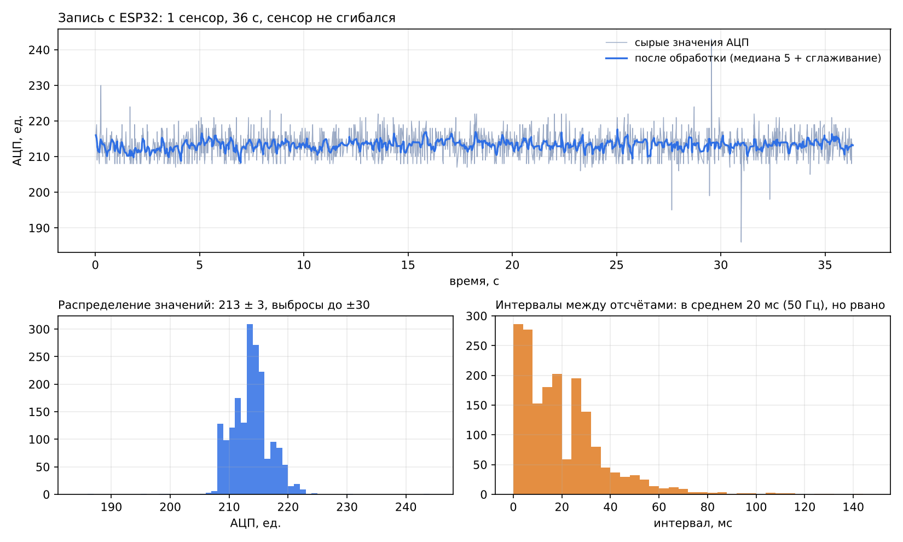

# Анализ потока с ESP32 (запись Захара, 25.10.2026)

Файл: `host/tests/data/esp32_one_sensor_2026-10.csv` — один сенсор, данные по Bluetooth в программу на Python.
Формат: `Time (s);Sensor Value (ADC)`, разделитель `;`, дробная часть через запятую (Excel).

## Что в данных

| Параметр | Значение | Вывод |
|---|---|---|
| Длительность / отсчётов | 36,3 с / 1815 | — |
| Средняя частота | 50,0 Гц (средний интервал 20 мс) | прошивка шлёт 50 раз в секунду |
| Интервалы между отсчётами | медиана 16 мс; 15 одинаковых меток времени; 101 интервал < 2 мс; 61 интервал > 60 мс; максимум 143 мс | время — это время **приёма на ПК**, BLE доставляет пакеты пачками |
| Значения | целые, среднее 213,2, СКО 3,3, диапазон 186…243 | сенсор всю запись **не сгибался** — это шум покоя |
| Выбросы | 17 одиночных отсчётов отклоняются от соседей больше чем на 8 единиц (до −27 / +30) | нужен медианный фильтр |
| После обработки (медиана по 5 + сглаживание) | СКО 1,2, отклонение не больше ±5 | фильтр приложения подавляет и шум, и выбросы |

## Выводы для обработки (реализовано в `host/flexglove/processing.py`)
1. **Медиана по 5 отсчётам** убирает одиночные выбросы, **экспоненциальное сглаживание** (α = 0,35,
   ≈ 50 мс при 50 Гц) — шум. Задержка обработки ≈ 2–3 отсчёта (40–60 мс).
2. **Порог «это сгиб, а не шум»:** автокалибровка включается при отклонении ≥ 30 единиц (≈ 10 СКО шума),
   ручная калибровка «ладонь/кулак» считается удачной при разнице ≥ 15 единиц. Проверено тестом на этой
   записи: за 36 с шум не дал ни одного ложного «сгиба».
3. **Гистерезис** состояния пальца: «согнут» при сгибе > 60 %, «разогнут» при < 40 % — без дребезга на границе.

## Вопросы и рекомендации команде
1. **Нужна запись со сгибами** — без неё неизвестна чувствительность. Протокол записи (можно прямо в приложении,
   вкладка «Сигналы → Начать запись»): 5 с покой → 5 раз согнуть/разогнуть с удержанием по 2 с → 5 с покой.
2. **Рабочая точка низко:** 213 из 4095 (если АЦП 12-битный) — около 5 % диапазона, ≈ 0,17 В. В самом
   низу диапазона АЦП ESP32 нелинеен и малочувствителен (на гистограмме виден «пол» около 208).
   Стоит подобрать резистор делителя так, чтобы в покое было 30–50 % диапазона (Лиза + Захар).
3. **Время устройства:** для датасетов добавить в пакет `millis()` и номер пакета (бинарный пакет v0.1,
   см. `docs/protocol.md`) — тогда задержки BLE не искажают временную шкалу.
4. **Пять каналов:** одна строка `v1;v2;v3;v4;v5` на отсчёт, 50 Гц, `BLEDevice::setMTU(185)` в прошивке.
