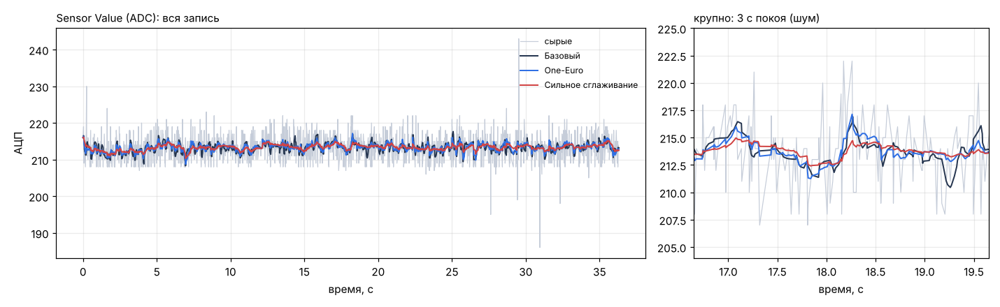
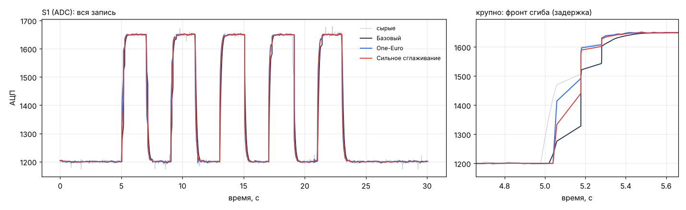

# Пресеты фильтрации: «Базовый» vs One-Euro vs «Сильное сглаживание» (этап 3)

Инструмент — `tools/evaluate.py` (метрики описаны в его заголовке). Повторить:

```
python tools/evaluate.py host/tests/data/esp32_one_sensor_2026-10.csv --compare one_euro smooth
python tools/evaluate.py --synthetic --compare one_euro smooth
```

## Данные
| Запись | Что это | Что по ней можно измерить |
|---|---|---|
| `host/tests/data/esp32_one_sensor_2026-10.csv` (= `data/recordings/sensor_data_test.csv`) | реальный поток Захара: 1 сенсор, 36 с покоя, 50 Гц, интервалы приёма 0…143 мс | шум и выбросы в покое, ложные переключения |
| синтетика по протоколу этапа 2 (`dsp/synthetic.py`) | 5 с покой → 5 × (сгиб 2 с / разгиб 2 с) → 5 с покой; шум СКО 3, выбросы ±25 (1 %), инерция сенсора 80 мс, пачки BLE как в записи Захара; размах 450 / 100 / 40 ед. | задержку на фронтах — правильный ответ известен |

Записи со сгибами с прототипа пока нет — после сессии этапа 2 её нужно прогнать той же командой и дописать сюда.

## Конвейеры
| Пресет | Описание |
|---|---|
| Базовый | `median(5) → ema(α 0,35)` — обработка версий 0.2–0.3 (побитно та же, тест `test_dsp_equivalence.py`) |
| One-Euro | `hampel(7, k 3) → one_euro(min_cutoff 0,7 Гц, beta 0,02, d_cutoff 1 Гц)` |
| Сильное сглаживание | `hampel(7, k 3) → one_euro(min_cutoff 0,3 Гц, beta 0,005)` |

## Результаты

### Реальная запись Захара (покой)


| Пресет | Шум в покое, СКО | Макс. отклонение | Ложных переключений (размах 60) |
|---|---|---|---|
| Базовый | 1,24 | 4,9 | 0 |
| One-Euro | 1,07 (−14 %) | 4,6 | 0 |
| Сильное сглаживание | 0,74 (−40 %) | 3,0 | 0 |

Ложных переключений нет ни у одного пресета даже при условном размахе сенсора 8 ед. — запас по шуму большой,
а гистерезис 0,4/0,6 работает.

### Синтетика по протоколу (задержка — по 50 % размаха, мс: сгиб / разгиб)


| Размах сенсора | Базовый | One-Euro | Сильное сглаживание |
|---|---|---|---|
| 450 ед. | 91 / 64 | **20 / 13** | 57 / 22 |
| 100 ед. | 90 / 63 | **51 / 21** | 81 / 56 |
| 40 ед. | 90 / 62 | **63 / 40** | 93 / 65 |
| Шум в покое, СКО | 1,22 | 1,03 | **0,64** |
| Ложные переключения | 0 | 0 | 0 |

## Выводы
1. **One-Euro лучше «Базового» по обоим показателям сразу:** в покое тише на 14–16 %, на фронте быстрее
   на 30–70 мс. Для управления захватом это заметно: 90 мс — уже ощутимая «вязкость».
2. **Главная находка — Хампель вместо медианы.** Медиана по 5 отсчётам даёт 2 отсчёта (40 мс) задержки на каждом
   фронте, а Хампель трогает только выбросы и пропускает нормальные отсчёты без изменений. Сравнение на синтетике
   (размах 450): `median(5) → one_euro` — 72 / 41 мс, `hampel(7) → one_euro` — 37 / 17 мс при почти том же шуме.
3. **beta у One-Euro зависит от масштаба сигнала** (скорость измеряется в единицах АЦП в секунду): у слабого
   сенсора (размах 40) выигрыш по задержке меньше — 27 мс вместо 70. Если у прототипа размах окажется маленьким,
   beta стоит поднять (0,05) — проверить `evaluate.py` на записи этапа 2. Более общее решение — нормировать
   скорость на размах калибровки (кандидат на этап 5).
4. **«Сильное сглаживание»** почти вдвое тише в покое при задержке как у «Базового». Его место — запись
   датасетов и демонстрация плавной руки, когда скорость реакции не важна.
5. **Фильтр 2-го порядка (биквад) проигрывает** после медианы: шум почти как у «Базового», задержка 180–230 мс.
   Причина: выход медианы уже низкочастотный, и обычный ФНЧ мало что добавляет, но запаздывает. Поэтому он остался
   блоком для своих конвейеров, но в пресеты не вошёл.
6. **Время отсчётов:** фильтрам, зависящим от времени, подаётся оценка периода (SampleClock, D-22), а не интервалы
   приёма. На синтетике с пачками BLE One-Euro устойчив (тест `test_one_euro_stable_with_bursty_timestamps`).

## Рекомендация
Пресет по умолчанию пока оставить «Базовым» — это обработка, проверенная на всех прошлых сценариях. One-Euro
включить на сессии с прототипом. Если запись со сгибами подтвердит выигрыш, сделать его пресетом по умолчанию
(одна строка `DEFAULT_PRESET` в `dsp/presets.py`).
