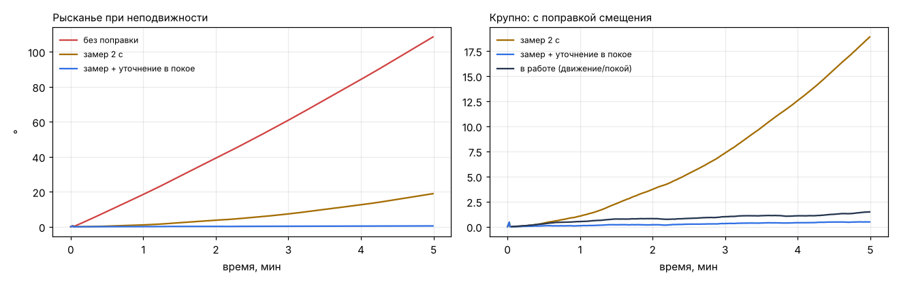
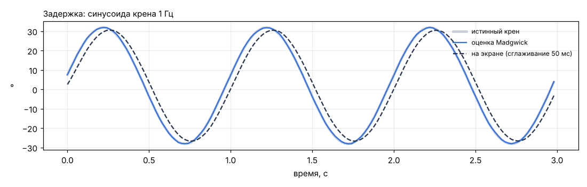
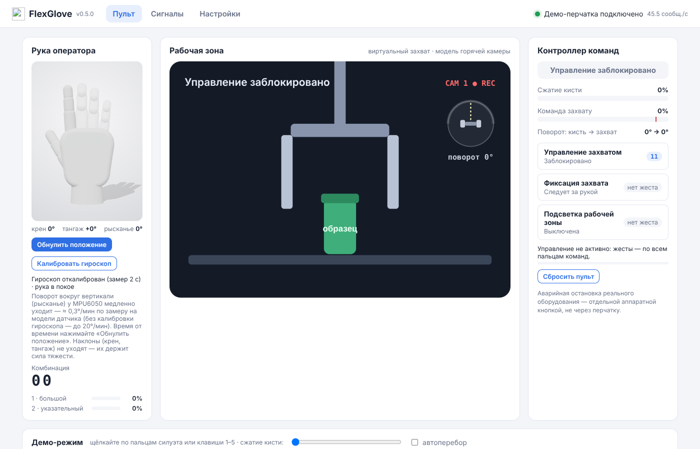
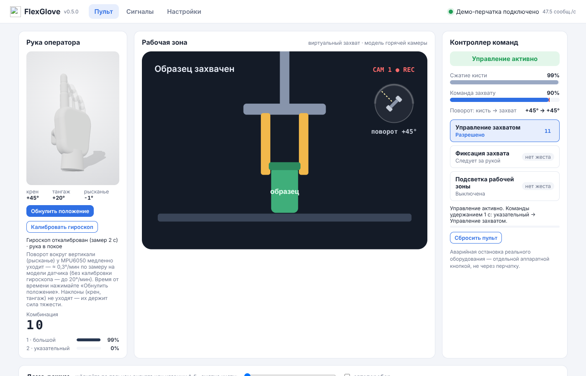
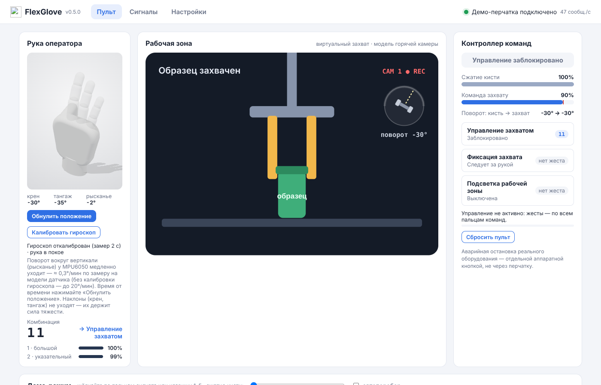

# Ориентация кисти по MPU6050 и 3D-рука (этап 4)

Железа с MPU6050 пока нет. Все числа ниже получены на **модели датчика** (`tools/evaluate_imu.py`) и в демо-режиме.
Отсчёты проходят тот же путь, что в приложении: строка v0.3 → `ImuTracker` (оси руки → смещение гироскопа → Madgwick).
После появления прототипа замеры нужно повторить на реальной записи.

```
python tools/evaluate_imu.py --out docs/analysis/img          # 5 мин модельного времени, ≈ 2 с счёта
```

## Модель MPU6050
| Параметр | Значение |
|---|---|
| Гироскоп: шум | 0,03 °/с (СКО при встроенном фильтре ≈ 44 Гц) |
| Гироскоп: смещение нуля | (0,5; −0,4; 0,3) °/с |
| Гироскоп: уход смещения | 0,1 °/с за 5 мин по Z (прогрев) + случайное блуждание 0,002 °/с/√с |
| Акселерометр: шум | 3 мг |
| Квантование протокола v0.3 | 1 мг, 0,1 °/с; 50 Гц |

## 1. Дрейф рысканья (поворот вокруг вертикали)


| Режим | Дрейф, °/мин | Уход за 5 мин, ° |
|---|---|---|
| без поправки смещения | 21,9 | 108 |
| только замер 2 с при подключении | 3,9 (растёт с прогревом) | 19 |
| **замер + уточнение в покое (как в приложении)** | **0,1** | **0,5** |
| в работе: 10 с движения / 5 с покоя | 0,23 | 1,5 (максимум) |

**Вывод.** Одного замера при подключении мало: смещение MPU6050 уходит при прогреве, и за 5 минут рысканье
уплывает на ~20°. Уточнение смещения в каждой паузе снижает дрейф до 0,1–0,25 °/мин. В интерфейсе честно написано
«≈ 0,3 °/мин по замеру на модели датчика». Наклоны (крен, тангаж) не дрейфуют вообще: их держит сила тяжести.

**Найденная ошибка (исправлена).** Детектор покоя смотрел только на разброс гироскопа. Поэтому поворот с постоянной
скоростью (45 °/с) он принимал за покой и «выучивал» как смещение: рысканье 90° давало ошибку 52°. Теперь покой
требует ещё и малой средней скорости за вычетом смещения: < 2 °/с, а до калибровки < 8 °/с.
Тест — `test_steady_rotation_is_not_learned_as_bias`.

## 2. Ошибка углов на известных поворотах
| Поворот | Madgwick: макс / СКО, ° | Комплементарный: макс / СКО, ° |
|---|---|---|
| крен 60° | 1,15 / 0,25 | 0,76 / 0,15 |
| тангаж −45° | 1,15 / 0,25 | 0,97 / 0,17 |
| рысканье 90° | 0,91 / 0,31 | 0,91 / 0,29 |
| три оси подряд | 1,27 / 0,34 | 0,88 / 0,27 |

Оба фильтра укладываются в 2°. На синтетике комплементарный чуть точнее. В приложении оставлен Madgwick (D-19):
он устойчивее при больших наклонах и не требует подстройки под частоту. Проверить на реальной записи на этапе 5.

## 3. Задержка


| Синусоида крена ±30° | Оценка ориентации | На экране (сглаживание 3D, τ = 50 мс) |
|---|---|---|
| 0,5 Гц | < 2 мс | 40 мс |
| 1 Гц | < 1 мс | 39 мс |
| 2 Гц | < 1 мс | 35 мс |

Фильтр ориентации задержки почти не добавляет. Основная задержка — сглаживание 3D (≈ 40 мс), это плата за отсутствие
рывков при 30 Гц обновлений. Визуально не заметно: порог заметности для движения руки ≈ 100 мс. Задержка BLE
(пачки до 140 мс) сюда не входит — её измерим на прототипе.

## 4. Пульт с 3D-рукой (демо, 2 сенсора)
| Исходная поза (после калибровки и обнуления) | Крен +45°, тангаж +20°, ARM, захват 90 %, поворот захвата +45° | Кулак, крен −30°, тангаж −35° |
|---|---|---|
|  |  |  |

Пальцы без сенсора — полупрозрачные и в нейтральном положении. Справа в рабочей зоне — шкала поворота захвата
(вид сверху): пунктиром — куда тянет кисть, губками — команда после контроллера.

## Ограничения и что проверить на железе
- Рысканье без магнитометра дрейфует всегда. При длинных сессиях — «Обнулить положение» или модуль с магнитометром
  (ICM-20948 / MPU9250), если это станет критичным.
- Крен для захвата — закрутка вокруг оси пальцев. Он устойчив, пока предплечье не вертикально: при пальцах вверх
  ось пальцев совпадает с вертикалью, и крен видит только гироскоп. Для управления захватом держать предплечье
  примерно горизонтально (естественная поза оператора).
- Вращение медленнее ~2 °/с от покоя не отличить (ограничение MEMS-гироскопа): такое движение постепенно уйдёт
  в оценку смещения.
- На прототипе: фото крепления модуля → пресет «как закреплён модуль»; запись 5 мин неподвижно и 5 мин в работе →
  `evaluate_imu.py` на реальных данных (нужен режим чтения CSV — задача этапа 5).
