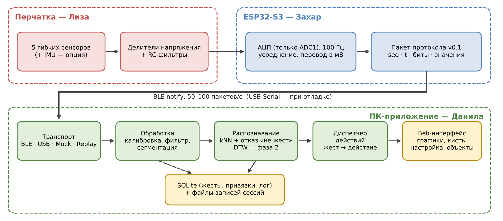

# Архитектура



Схема на изображении относится к прежнему контроллеру; актуальный путь аудиожестов показан ниже.

**Демонстрация v0.7.0 (D-35…D-38):** обучаемый статический жест → локальная аудиофраза.
ESP32 передаёт прежние сырые АЦП/IMU, формат не меняется. Демо работает независимо от прошивки.
Прежний контроллер сохранён; старый автомат команд больше не вызывается ядром.

```text
BLE / порт / демо / CSV → parser → фильтры → фиксированная калибровка → сгибы доступных каналов
                                                                     ↓
                         SQLite static_gestures ← обучение / совместимость / RMS / удержание
                                                                     ↓ событие
                                                           AudioPlayer FIFO → поток → pygame → устройство ПК
IMU → ориентация → 3D-рука                engine.snapshot / WebSocket → все вкладки (наблюдение)
```

`gestures.py` не знает об аудио и браузерах. Ядро подаёт новые полные свежие отсчёты и монотонное время,
проверяет калибровку и блокировки; распознаватель выдаёт одно событие. `audio.py` отдельно принимает задание,
проверяет ограничение пути, очередь и дедупликацию. Рабочий поток публикует результат воспроизведения.
На отключении/устаревании/смене контекста очередь очищается, автомат требует нового выхода.
Детали порогов, контекста, профилей, API и реальной приёмки — [gesture-audio.md](gesture-audio.md).

## ПК-приложение (`host/`)


| Модуль | Ответственность |
|---|---|
| `sources/` | BLE (bleak; несколько notify-характеристик = несколько каналов), порт, демо (реалистичный сигнал 5 сенсоров), воспроизведение CSV |
| `parser.py` | байты → `Frame`: значения / значения с метками / биты; автоопределение формата |
| `processing.py` | канал целиком: конвейер фильтров из `dsp/` → калибровка → сгиб 0..1 → 0/1 с гистерезисом (прежний интерфейс) |
| `dsp/` | обработка сигналов (этап 3, D-18): фильтры-блоки и конвейеры, пресеты, калибровка, признаки, «покой / движение», распознаватели, ориентация IMU, синтетика — см. раздел ниже и [dsp.md](dsp.md) |
| `engine.py` | каналы, запуск обучаемых жестов и аудиоочереди, блокировки/совместимость, калибровка, IMU (v0.3), запись, предупреждения потока, состояние для интерфейса |
| `gestures.py`, `audio.py` | обучение/совместимость/распознавание и отдельная ограниченная очередь MP3 |
| `commands.py` | архивная обёртка (Engine её не вызывает): распознаватель команд D-21 переехал в `dsp/recognizers/combo.py` |
| `imu.py` | ориентация кисти (этап 4, D-24): оси датчика → оси руки (8 пресетов крепления), смещение гироскопа (замер 2 с, покой), Madgwick, «обнулить положение», крен кисти |
| `control.py` | безопасный контроллер захвата: разрешение управления, фиксация, мёртвая зона, ограничение скорости и сжатия, реакция на потерю связи |
| `recording.py` | запись сырых значений в CSV (формат Excel, как у программы Захара) |
| `actions.py` | команды оператора: управление (ARM), фиксация захвата, подсветка |
| `app.py` | REST `/api/*` и WebSocket `/ws` |
| `desktop.py` | запуск без консоли: сервер + браузер по умолчанию + значок в трее |
| `calib_wizard.py` | мастер калибровки (этап 4б): замеры «ладонь» и «кулак» по 3 с, уровни (медиана), шум (робастный разброс), размах, оценка канала; сохраняет только по кнопке |
| `web/` | вкладки «Рука» (главный экран, D-26), «Сигналы», «Настройки»; 3D-рука (`hand3d.js`: модель glTF со скелетом, фиксированный центр ладони без контактной тени (D-33), `handpose.js`: сгиб → углы суставов, `vendor/`: three.js r170, GLTFLoader, OrbitControls, модель generic-hand) или 2D-силуэт; график каналов; мастер калибровки. `index.html` отдаётся с версией в ссылках (`?v=`), статика — `Cache-Control: no-cache` |

## Модуль `dsp/` (этап 3)

```
сырое АЦП ─▶ Pipeline ─▶ калибровка, сгиб 0..1 ─▶ Hysteresis ─▶ биты ─▶ распознаватели (Sample → [Event])
              │ блоки: median, hampel, ema, one_euro, biquad_lp, deadband; JSON-описание; пресеты
              └─▶ признаки по окну ─▶ детектор «покой / движение» (HandSegmenter → motion в состоянии)
IMU (v0.3) ─▶ imu.py: оси руки ─▶ смещение гироскопа (ImuRestDetector) ─▶ Madgwick ─▶ q_world (наклоны по гравитации,
             рысканье от обнуления, D-28) ─▶ 3D-рука; поза от исходной (q_rel) ─▶
                                                                                   крен кисти ─▶ control.py: поворот захвата
```

| Файл | Ответственность |
|---|---|
| `filters.py` | интерфейс `Filter` (`reset`, `process(x, t)`), реестр `@register`, блоки, `Pipeline`, `SampleClock` (D-22) |
| `presets.py` | пресеты конвейера и проверка своего описания (D-23) |
| `calibration.py`, `normalize.py` | калибровка «ладонь/кулак», автокалибровка, сгиб 0..1 |
| `features.py`, `segmentation.py` | среднее/СКО/размах/скорость по окну; покой / движение по каналу и руке |
| `recognizers/` | `base` (Sample, Event, Recognizer), `threshold` (гистерезис), `combo` (D-21), заготовки `knn_pose`, `dynamic` |
| `orientation.py` | кватернионы, оценка смещения гироскопа, комплементарный фильтр, Madgwick, `OrientationEstimator` |
| `synthetic.py` | сигналы (ступенька, рампа, протокол, шум, выбросы, пачки BLE) и IMU по известным вращениям |

Офлайн: `tools/evaluate.py` прогоняет запись через любые конвейеры (шум, задержка, ложные переключения, PNG);
`tools/analyze_recording.py` — разбор записи со сгибами. В `host/flexglove` нет numpy/scipy — только стандартная
библиотека; numpy и matplotlib нужны лишь инструментам из `tools/`.

### Безопасность (границы ответственности ПО)
Контроллер команд — программный слой демонстратора. Аварийная остановка, ограничение усилия и защита
от потери связи на реальном оборудовании должны быть **независимыми** (аппаратными) механизмами.

### Асинхронность
Один цикл `asyncio` (uvicorn): BLE — асинхронно, порт — в отдельном потоке. Такт ядра 50 Гц (20 мс),
рассылка состояния в интерфейс — 30 Гц.

### Изоляция источников и сцена (v0.6.2)
При смене источника и переподключении Engine сбрасывает состояние обработки и незавершённые замеры.
Для mock использует диапазоны самого генератора в памяти; реальные уровни берёт из SQLite. В демо
операции записи/сброса пользовательской калибровки возвращают 409 (D-34).
В 3D постоянная точка ладони переводится в начало pivot до поворота IMU. Камера смотрит туда же,
проекция сдвигается к центру области между верхней подписью и полосой демо. Радиус рассчитывается
однократно для модели в покое; анимация пальцев центр не меняет (D-33).
